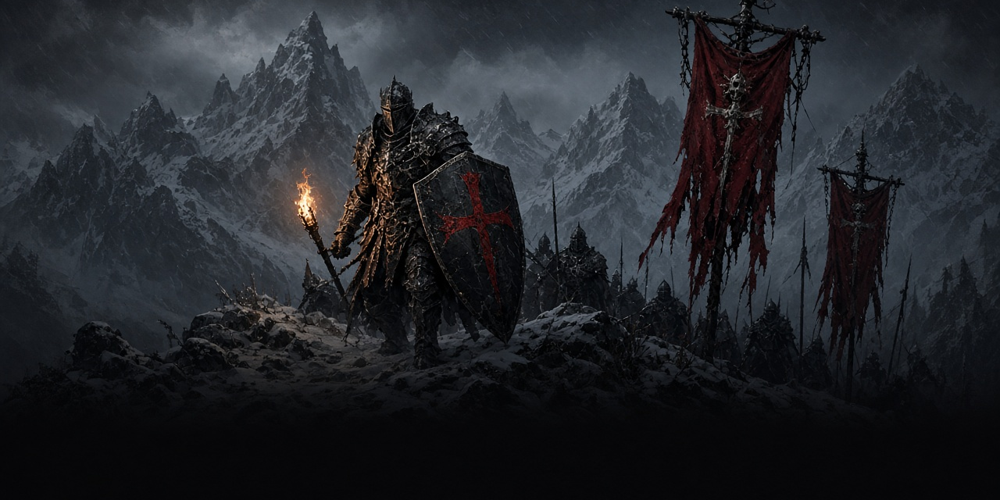
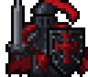

# Blackshield Company

A Skyrim Special Edition mod: join a mercenary company, take radiant contracts across Skyrim's holds, and rise from Recruit to Commander.

**Status: v0.1.2, early beta.** The courier letter now starts on 1.6. v0.1.2 shipped without the SEQ file, so a new game never got it. See [docs/TESTING.md](docs/TESTING.md).

Also by the same author and fully compatible: [Daedric Ledger: Bounties of Oblivion](https://github.com/Blackshield-Company/bounties-of-oblivion).

- Game: Skyrim Special Edition / Anniversary Edition 1.6.x (also fine on 1.5.97). Works on Windows and on Linux through Proton.
- Requirements: none beyond the base game. No SKSE, no SkyUI, no DLC.
- Plugin: `BlackshieldCompany.esp`, ESL-flagged, so it doesn't use a full load-order slot. Skyrim.esm is the only master.

## What it does

| Feature | How it works |
|---|---|
| Recruitment | Once you're level 2 and past the Helgen intro, a courier hands you a sealed letter. Read it and sign. |
| Company Ledger | You get a **Company Ledger** lesser power and a ledger book. Either one opens the company menu. |
| Contracts | **Clear the Camp**: kill a bandit camp's leader. **Marked for Death**: hunt one of five named targets and their bodyguards near a dungeon. **Hold the Line**: defend a fort against three waves of raiders. Locations are picked by the game's radiant system from vanilla locations inside Skyrim's holds. |
| Pay | Gold based on contract type, your level and your rank. A share (20% by default) goes to the company treasury. |
| Ranks | Renown from contracts: Recruit, Blade (100), Sergeant (300), Captain (700), Commander (1500). |
| Rewards | Blade: *Blackshield Blade*. Sergeant: *Blackshield Shield*. Captain: *Blackshield Plate*, treasury access, company sellsword. Commander: *Commander's Presence* (+25 Health and Stamina) and +25% contract pay. |
| Treasury | Captains and Commanders can withdraw from it through the ledger. |
| Sellsword | From Captain, the ledger can call a Blackshield sellsword who follows you through the vanilla follower system. |

The gear reuses vanilla meshes (ebony sword and shield, steel plate cuirass) with new names, stats and enchantments. There is no new voice acting; all company interaction goes through the letter, the ledger and message boxes.

## Install

Grab `BlackshieldCompany-<version>.zip` from [Releases](https://github.com/Blackshield-Company/blackshield-company/releases) (it's a FOMOD installer).

- **Mod Organizer 2**: *Install a new mod from an archive*, pick the zip, then enable `BlackshieldCompany.esp` in the right pane.
- **Vortex**: drag the zip into the Mods page, install and enable it.
- **Manual (Linux/Proton, no mod manager)**: copy everything inside `00 Core/` from the zip into `.../steamapps/common/Skyrim Special Edition/Data/`. Then add the line `*BlackshieldCompany.esp` to
  `.../steamapps/compatdata/489830/pfx/drive_c/users/steamuser/AppData/Local/Skyrim Special Edition/Plugins.txt`.

It's safe to add to an existing save. Uninstalling mid-playthrough is not recommended, as with any scripted mod.

## Build from source

The release zip is built entirely from this repo by `./build.sh` on Linux:

1. **Papyrus**: `src/papyrus/*.psc` are compiled to `.pex` with the open-source [papyrus-compiler](https://github.com/russo-2025/papyrus-compiler) (MIT, native Linux). The build downloads it and verifies its checksum. It type-checks against clean-room API declarations in `tools/modkit/papyrus-stubs`.
2. **Plugin**: `src/plugin/BlackshieldCompany.Generator` is a C# program that uses [Mutagen](https://github.com/Mutagen-Modding/Mutagen) to write `BlackshieldCompany.esp` from code. It then re-reads the plugin and validates it: ESL range, masters, dangling links, and every script property against the `.psc` sources.
3. **FOMOD**: `tools/modkit/fomod/pack.py` validates `fomod/ModuleConfig.xml` against the FOMOD schema and writes a reproducible zip to `dist/`.

Requirements: .NET SDK 9 or newer, python3, curl, and optionally `xmllint` (libxml2) for the schema check. No Creation Kit or Wine needed.

```bash
./build.sh
# Optional: type-check the scripts against your game's own sources
# (unpack Data/Scripts.zip from your install first):
./build.sh -H "/path/to/Skyrim Special Edition/Data/Source/Scripts"
```

`src/plugin/formids.json` pins every record's FormID. Never edit or reuse entries, or existing saves will break.

## Layout

```
src/papyrus/                 Papyrus sources (.psc)
src/plugin/                  Mutagen plugin generator + pinned FormIDs
fomod/                       FOMOD installer config (info.xml, ModuleConfig.xml)
docs/                        Testing checklist, design notes, Nexus page and upload fields
tools/modkit/                Reusable tooling shared by the whole mod series
build.sh                     One-command build
```

`tools/modkit/` is written to be reused by the next mods in the series (Bounties of Oblivion, Contract Hunter, Steel Oath, Ember Smithing). See [tools/modkit/README.md](tools/modkit/README.md).

## Support

Donations are optional. Nothing in the mod is gated on them.

- GitHub Sponsors: https://github.com/sponsors/synthalorian
- Ko-fi: https://ko-fi.com/synthalorian

## Credits and licenses

- Code in this repo: MIT (see `LICENSE`).
- [Mutagen](https://github.com/Mutagen-Modding/Mutagen) by Noggog and contributors (GPL-3.0). It's used as a build tool and isn't redistributed.
- [papyrus-compiler](https://github.com/russo-2025/papyrus-compiler) by russo-2025 (MIT). It's downloaded at build time.
- FOMOD schema from [GandaG/fomod-schema](https://github.com/GandaG/fomod-schema) (MIT).
- Skyrim and its assets belong to Bethesda Softworks. This repo contains no Bethesda assets or script sources. The plugin only references vanilla records by FormID and vanilla meshes by path.

## Support

Donations are optional. Nothing in the mod is gated on them.

- GitHub Sponsors: https://github.com/sponsors/synthalorian
- Ko-fi: https://ko-fi.com/synthalorian

<p><br><sub>A <a href="https://github.com/synthalorian">Blackshield Company</a> mod.</sub></p>
